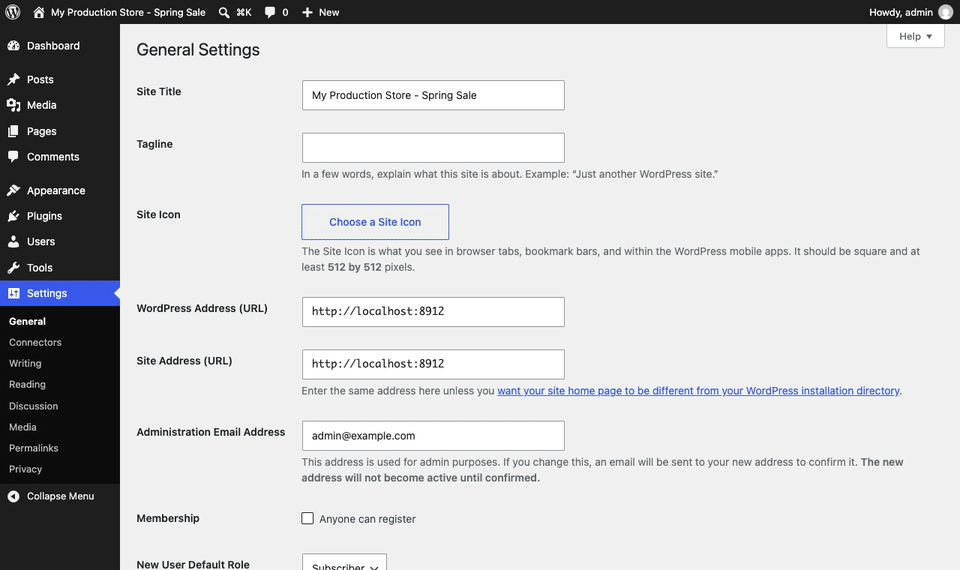
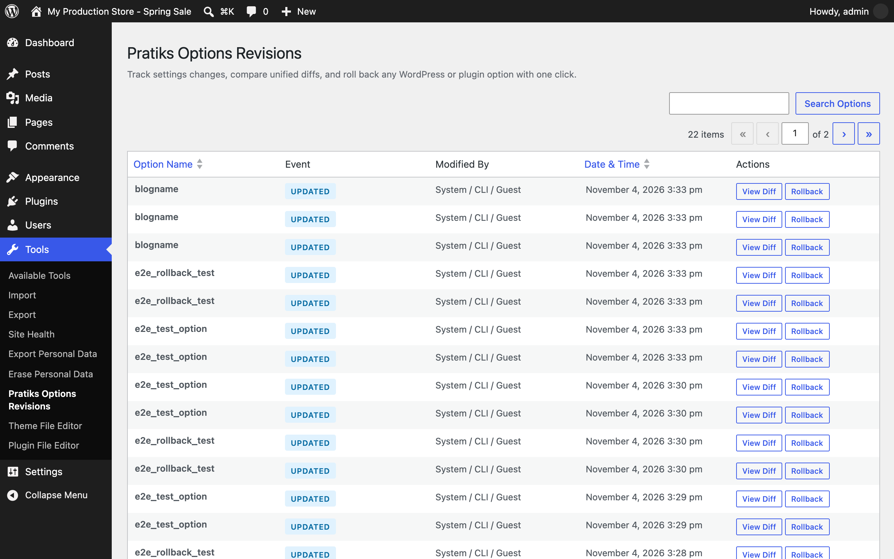
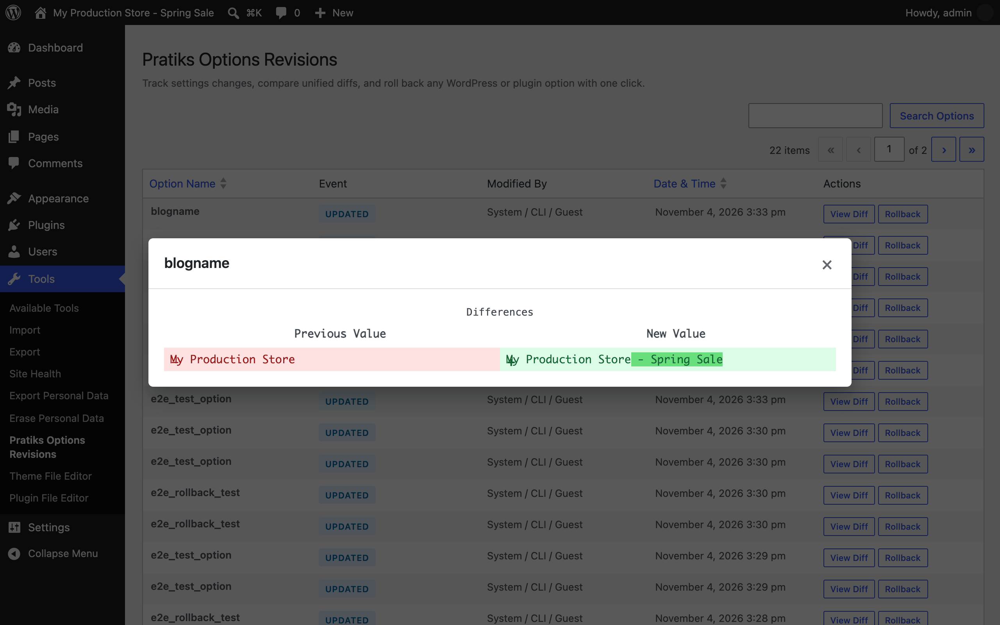

<p align="center"></p>

<h1 align="center">Pratiks Options Revisions</h1>

<p align="center">
  <a href="https://playground.wordpress.net/?blueprint-url=https://raw.githubusercontent.com/pratik-londhe4/pratiks-options-revisions/main/blueprint.json"></a>
  <a href="https://github.com/pratik-londhe4/pratiks-options-revisions/releases/latest"></a>
  
  
  <a href="LICENSE.md"></a>
  <br>
  <a href="https://github.com/pratik-londhe4/pratiks-options-revisions/actions/workflows/phpcs.yml"></a>
  <a href="https://github.com/pratik-londhe4/pratiks-options-revisions/actions/workflows/phpstan.yml"></a>
  <a href="https://github.com/pratik-londhe4/pratiks-options-revisions/actions/workflows/unit-tests.yml"></a>
  <a href="https://github.com/pratik-londhe4/pratiks-options-revisions/actions/workflows/e2e-tests.yml"></a>
  <a href="https://github.com/pratik-londhe4/pratiks-options-revisions/actions/workflows/plugin-check.yml"></a>
</p>

<p align="center">Track settings changes, compare unified diffs, and roll back any WordPress or plugin option with one click.</p>

<p align="center">
  
</p>

---

WordPress core provides native revisions for posts and pages, but site settings in `wp_options` have no safety net. When a plugin update silently alters a critical configuration, an admin tweaks permalinks or WooCommerce settings and breaks something, or an automated process corrupts an option, finding what changed—and restoring the previous value—normally requires digging through database backups.

Pratiks Options Revisions captures the previous and new values whenever options are added, updated, or deleted. It formats complex arrays and objects into clear JSON diffs, displays changes in a visual diff modal, and lets you roll back any setting instantly.

> [!NOTE]
> Free and open source under the GPL. No pro version, no upsells, no ads in wp-admin, no tracking. Clean, standalone, and safe.

## Features

- **Automatic snapshot capture**: Hooks into `updated_option`, `added_option`, and `deleted_option` to record old and new values, user ID, timestamp, and IP.
- **Smart noise filtering**: Automatically skips high-churn keys (`_transient_*`, `_site_transient_*`, `cron`), session tokens, and security nonces/salts (`auth_key`, passwords). Custom filters allow ignoring any key.
- **Formatted JSON diffs**: Scalars diff as plain text, while complex serialized objects and PHP arrays are converted to pretty-printed JSON so you can see exactly which key changed.
- **One-click rollback**: Restores options to any recorded revision with nonce and capability protection, plus recursion guards so rollbacks do not trigger infinite loops.
- **Tools admin screen**: Filter revisions by option name, inspect before/after values with WordPress's native `wp_text_diff()`, and roll back with confirmation.
- **WP-CLI support**: Inspect and revert settings from the terminal via `wp pratiks-options-revisions list`, `diff`, `rollback`, and `purge`.
- **WordPress 6.9+ Abilities API & MCP**: Ready for AI workflows and autonomous agents with read and rollback abilities.
- **Automated pruning**: Daily cron keeps the table lean by pruning old revisions (configurable retention days and maximum revisions per option).
- **Privacy & Site Health**: Diagnostic check in Site Health and native WP privacy tools for personal data export and erasure.

## Install

1. Download `pratiks-options-revisions.zip` from the [latest release](https://github.com/pratik-londhe4/pratiks-options-revisions/releases/latest).
2. In WordPress, go to **Plugins > Add New Plugin > Upload Plugin**, choose the zip and activate it.

Or with WP-CLI:

```sh
wp plugin install https://github.com/pratik-londhe4/pratiks-options-revisions/releases/latest/download/pratiks-options-revisions.zip --activate
```

Needs WordPress 6.6+ and PHP 7.4+. The **Try in WordPress Playground** badge opens a throwaway WordPress in your browser with the plugin active and sample revisions ready to explore.

## Quick look

Check recent option changes and inspect diffs using WP-CLI:

```sh
# List recent revisions
wp pratiks-options-revisions list

# Filter revisions for a specific setting
wp pratiks-options-revisions list --option=blogname

# View a unified visual diff of what changed
wp pratiks-options-revisions diff 42

# Roll back an option to revision 42
wp pratiks-options-revisions rollback 42
```

Or tune retention and filters in your theme or mu-plugin:

```php
// Keep 60 days of revisions instead of 30
add_filter( 'pratiks_options_revisions_retention_days', function() {
    return 60;
} );

// Exclude custom plugin cache options from revision history
add_filter( 'pratiks_options_revisions_should_ignore', function( $ignore, $option ) {
    return str_starts_with( $option, 'my_app_cache_' ) ? true : $ignore;
}, 10, 2 );
```

## Screenshots

<table>
  <tr>
    <td width="50%" valign="top"> Pratiks Options Revisions"><br><sub>Revisions list table under Tools > Pratiks Options Revisions</sub></td>
    <td width="50%" valign="top"><br><sub>Unified visual diff modal showing previous and new option values</sub></td>
  </tr>
</table>

## Documentation

| Doc | What it covers |
| --- | --- |
| [Reference](docs/REFERENCE.md) | Filters, actions, JavaScript hooks, Abilities API, and WP-CLI commands |
| [Development](docs/DEVELOPMENT.md) | Local setup, commands, PHPCS, PHPStan, and tests |
| [Contributing](docs/CONTRIBUTING.md) | Pull requests, required checks, and PR titles |
| [Releasing](docs/RELEASING.md) | How Conventional Commits and pull requests become releases |
| [Security](docs/SECURITY.md) | Reporting a vulnerability |
| [readme.txt](readme.txt) | WordPress.org plugin directory description, FAQ, and changelog |

## Project structure

```
pratiks-options-revisions.php     plugin header, autoloader, activation & boot
uninstall.php                    clean removal of custom table and options
src/
├── Plugin.php                   service container and lifecycle bootstrap
├── Capture/
│   └── OptionListener.php       hooks into updated_option, added_option, deleted_option
├── Storage/
│   ├── Database.php             custom table schema and dbDelta install
│   └── RevisionRepository.php   CRUD operations, filtering, and pruning
├── Diff/
│   └── DiffEngine.php           JSON normalization and wp_text_diff generation
├── Admin/
│   ├── AdminPage.php            Tools > Pratiks Options Revisions admin controller
│   └── RevisionsListTable.php   WP_List_Table for searching and filtering revisions
├── Rollback/
│   └── RollbackHandler.php      safe rollback execution with recursion guards
├── Cron/
│   └── PruneTask.php            daily pruning of expired and excess revisions
├── Cli/
│   └── Command.php              WP-CLI command suite
├── Abilities.php                WordPress 6.9+ Abilities API and MCP definitions
├── Health/
│   └── SiteHealth.php           Site Health diagnostic status check
└── Privacy/
    └── Privacy.php              GDPR personal data exporter, eraser, and privacy text
assets/
├── css/admin.css                modal styles and diff rendering
└── js/admin.js                  diff modal handlers and rollback confirmation
tests/
├── Unit/                        PHPUnit test cases with Brain Monkey isolation
└── e2e/                         Playwright test harness and Docker environment
docs/                            reference, development, contributing, releasing
```

## More free plugins

| | Plugin | What it does |
| --- | --- | --- |
|  | [Pratiks 3D Model Embedder](https://github.com/pratik-londhe4/pratiks-3d-model-embedder) | Upload GLB, glTF, STL and OBJ files and show them in posts as interactive 3D models visitors can rotate |

## License

Copyright (c) Pratik Londhe. Licensed under [GPL-2.0-or-later](LICENSE.md).
